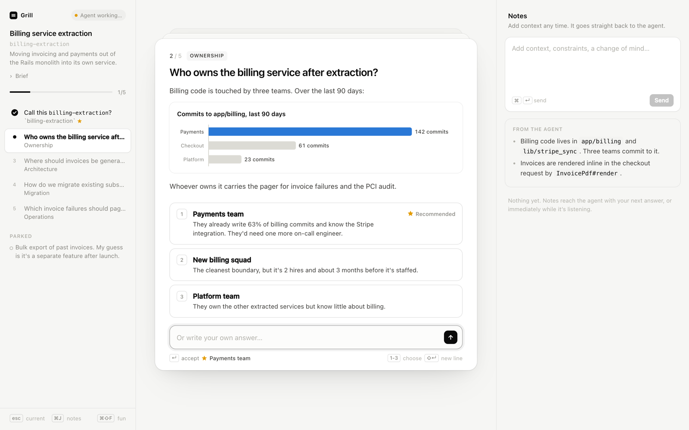
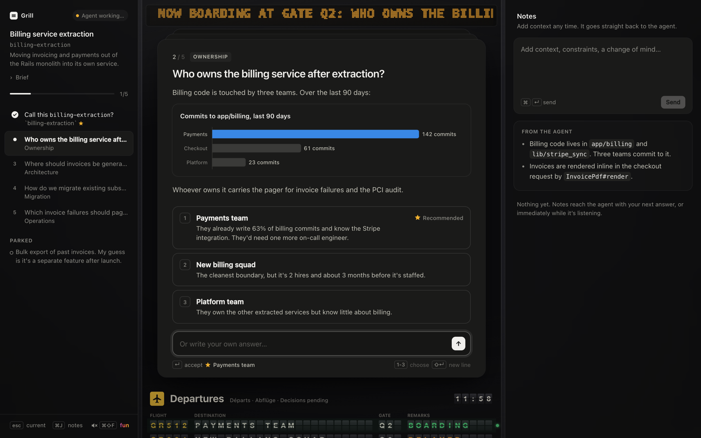

# grill-ui

Your coding agent interviews you about a plan until every decision is settled. The questions show up in your browser, one card at a time, each with the context, a chart or diagram when it helps, and a ★ on the answer the agent recommends.



It works with Claude Code, Codex and any agent that reads `SKILL.md` skill folders. It needs Node 18 or newer and nothing else. No npm install, no accounts, no keys. The UI only listens on `127.0.0.1`, so nobody else can reach it. The one outside request is Mermaid, loaded from a CDN when a question has a diagram.

## Install

```bash
curl -fsSL https://raw.githubusercontent.com/DJGrey/grill/main/install.sh | bash
```

That downloads the skill to `~/.grill-ui`, links it into your agents' skill folders, and lets Claude Code open the UI without asking each time. Run the same line again to update.

<details>
<summary>Other ways to install</summary>

**As a Claude Code plugin.** Updates come through `/plugin`, and the command is `/grill-ui:grill-ui`. Claude Code asks once before the UI first opens, so pick "don't ask again".

```
/plugin marketplace add DJGrey/grill
/plugin install grill-ui@grill-ui
```

**From a clone.** Handy if you want to change it.

```bash
git clone https://github.com/DJGrey/grill.git && cd grill && ./install.sh
```

**Uninstall** with `~/.grill-ui/install.sh --uninstall`, then delete `~/.grill-ui`.

</details>

## Use it

Ask your agent to grill you:

> grill me on moving our billing code into its own service

In Claude Code you can also type `/grill-ui`. The agent opens the UI, researches what it needs, then queues up questions. Answer them in the browser. Your answers go straight back to the agent, which logs each decision and writes the next questions. When every branch is settled, you get the decision log in chat.

| Key | Does |
|---|---|
| `1`–`9` | Pick an option |
| `Enter` | Send. With nothing picked, it takes the ★ recommendation. |
| `↑` `↓` | Move between options |
| Just type | Write your own answer, or add to a pick |
| `⌘J` | Notes, for context the agent should know whenever |
| `⌘⇧F` | Fun mode |

## Fun mode

Flip the "fun" switch in the sidebar (or press `⌘⇧F`) and every question gets a silly background: a departures board of your options, a courtroom, a trading floor, a nature documentary, a group chat with your mum in it, and about 25 more. Now and then a little game turns up while the agent thinks. Shoot clay pigeons. Whack the moles that relitigate your decisions. Shoo the goose that steals your notes panel. There are achievements.



It's off by default, respects reduced motion, and never touches your answer.

## How it works

The agent writes the questions to a markdown file, `.context/<slug>/grill.md` in your repo, and keeps `.context/` out of git with your local ignore list. A small Node server renders that file live and records your answers in a folder next to it. The agent runs `grill.mjs wait`, which returns the moment you answer.

The file format is in [skills/grill-ui/references/format.md](skills/grill-ui/references/format.md), with a full example in [example.md](skills/grill-ui/references/example.md).

Running on a [Conductor](https://conductor.build) cloud workspace with no screen? The UI shows up at the workspace preview URL instead.

## Make it yours

Put house rules in `~/.config/grill-ui/instructions.md` and the agent follows them in every grill. Use it for how you like questions written, or what should happen when a grill finishes, like writing a spec in your team's format. It overrides the skill where they disagree, and updates never touch it.

## Contributing

Ideas and new fun-mode scenes are welcome. [skills/grill-ui/scripts/web/fun/README.md](skills/grill-ui/scripts/web/fun/README.md) explains how to write a background or a game and how to test it.

## License

MIT
