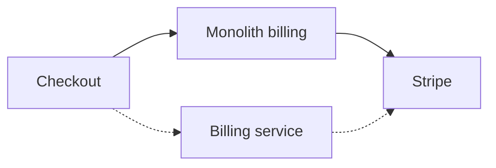
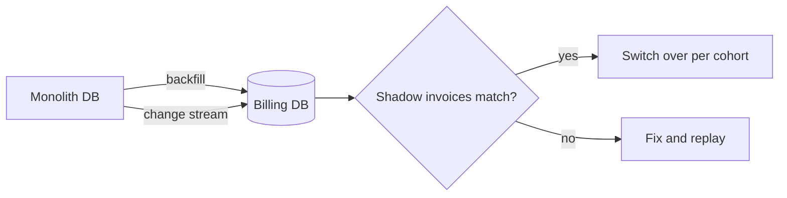

We're splitting billing out of `app/` so it can ship on its own and stop
blocking checkout deploys. The target is the first invoice generated by the new
service by the end of Q1.



## What I found

- Billing code lives in `app/billing` and `lib/stripe_sync`. Three teams commit to it.
- Invoices are rendered inline in the checkout request by `InvoicePdf#render`.

## Q1. Call this `billing-extraction`? {#slug}
tag: Setup

It names the folder in `.context/` that holds this grill.

### Options
- ★ **`billing-extraction`.** Short, and it says what changes.

## Q2. Who owns the billing service after extraction? {#owner}
tag: Ownership

Billing code is touched by three teams. Over the last 90 days:

```chart
{
  "type": "hbar",
  "title": "Commits to app/billing, last 90 days",
  "unit": "commits",
  "data": { "Payments": 142, "Checkout": 61, "Platform": 23 },
  "highlight": "Payments"
}
```

Whoever owns it carries the pager for invoice failures and the PCI audit.

### Options
- ★ **Payments team.** They already write 63% of billing commits and know the Stripe integration. They'd need one more on-call engineer.
- **New billing squad.** The cleanest boundary, but it's 2 hires and about 3 months before it's staffed.
- **Platform team.** They own the other extracted services but know little about billing.

## Q3. Where should invoices be generated? {#invoice-gen}
tag: Architecture

Invoices are generated inline in the checkout request today. That's most of
checkout's tail latency.

```chart
{
  "type": "stats",
  "items": [
    { "label": "Checkout p95", "value": 420, "unit": "ms", "delta": "+38% QoQ", "good": "down" },
    { "label": "Invoice share of p95", "value": "71%" },
    { "label": "Invoices per day", "value": 18400 }
  ]
}
```

```chart
{
  "type": "bar",
  "title": "Projected checkout p95 by approach",
  "unit": "ms",
  "data": { "Inline (today)": 420, "Async worker": 120, "Nightly batch": 110 },
  "highlight": "Async worker"
}
```

### Options
- ★ **Async worker on the existing queue.** It takes invoicing off the request path, so customers see checkout finish 300ms sooner. It needs idempotency keys so retries don't double-invoice.
- **Keep it inline and optimise.** No new moving parts, but the PDF render alone is 180ms.
- **Nightly batch.** The cheapest, but customers wait up to a day for a receipt. Support says that creates tickets.

## Q4. How do we migrate existing subscriptions? {#migration}
tag: Migration
depends: invoice-gen

There are **41,200** active subscriptions. The new service needs its own copy of
each plan, billing date and payment method reference.



| Approach | Downtime | Rollback | Effort |
|---|---|---|---|
| Switch everything at once | About 2h | Restore a snapshot | 1 week |
| Write to both databases | None | Flip a flag | 3 weeks |
| Backfill, then switch cohort by cohort | None | Per cohort | 4 weeks |

> [!WARNING] Annual plans renew on the 1st
> 9,800 annual subscriptions renew on Jan 1. Whatever we pick can't be halfway through then.

### Options
- **Switch everything at once.** The simplest, but checkout is down for about 2 hours.
- **Write to both databases.** No downtime, but bugs where the two drift apart are subtle and hard to spot.
- ★ **Backfill, then switch cohort by cohort.** We compare shadow invoices for each cohort before switching it. It's the slowest, but every step can be undone.

## Q5. Which invoice failures should page someone? {#paging}
tag: Operations
depends: owner
multi: true

Failed invoices over the last 12 weeks:

```chart
{
  "type": "line",
  "title": "Failed invoices per week",
  "x": ["W1","W2","W3","W4","W5","W6","W7","W8","W9","W10","W11","W12"],
  "series": [
    { "name": "Card declined", "values": [210,190,230,205,220,240,215,260,230,250,245,270] },
    { "name": "Tax calculation error", "values": [12,8,15,9,30,11,14,10,48,13,12,16] },
    { "name": "PDF render timeout", "values": [4,6,3,5,4,7,5,6,4,9,22,31] }
  ]
}
```

### Options
- **Card declined.** High volume, and the customer can fix it. Dunning emails already cover it.
- ★ **Tax calculation error.** Low volume, but each one is a compliance problem.
- ★ **PDF render timeout.** It has climbed sharply in the last two weeks.
- **Any failure above 1% of daily volume.** A catch-all threshold alert.

Pick every one that should page. The rest go to a daily digest.

## Parked

- Bulk export of past invoices. My guess is it's a separate feature after launch.

## Decisions so far
